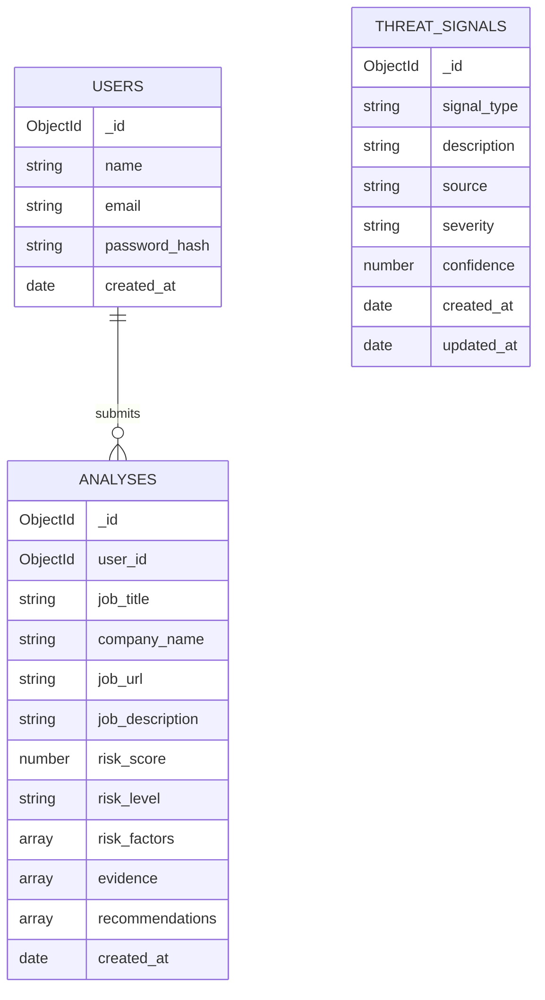

# HireShield AI — Database Design

## 1. Database

- **Database:** MongoDB
- **Purpose:** Store user accounts, job-analysis history, and threat signals used to assess suspicious job postings.
- **MVP collections:** `users`, `analyses`, and `threat_signals`.
- **Future scope:** `reports` (community reporting) is excluded from the MVP.

## 2. Collections

### 2.1 `users`

Stores registered user account details.

| Field | Type | Description |
|---|---|---|
| `_id` | ObjectId | Unique user identifier |
| `name` | String | User's display name |
| `email` | String | User's email address; must be unique |
| `password_hash` | String | Hashed password; never store a plain-text password |
| `created_at` | Date | Account creation timestamp |

### 2.2 `analyses`

Stores each submitted job posting and the result of its analysis. Each document represents one analysis-history entry.

| Field | Type | Description |
|---|---|---|
| `_id` | ObjectId | Unique analysis identifier |
| `user_id` | ObjectId | References the user who submitted the job |
| `job_title` | String | Job title, if provided or extracted |
| `company_name` | String | Company name, if provided or extracted |
| `job_url` | String | Submitted job-posting URL |
| `job_description` | String | Submitted or extracted job description |
| `risk_score` | Number | Overall risk score from 0 to 100 |
| `risk_level` | String | `Low`, `Medium`, or `High` |
| `risk_factors` | Array | Suspicious indicators detected |
| `evidence` | Array | Supporting details and evidence status for detected indicators |
| `recommendations` | Array | Safety actions suggested to the user |
| `created_at` | Date | Time the analysis was created |

**Suggested structure for array items**

- `risk_factors`: `{ signal_type, description, severity }`
- `evidence`: `{ signal_type, details, status }`
- `recommendations`: strings containing practical safety steps

### 2.3 `threat_signals`

Stores reusable threat indicators and intelligence that the analysis engine can consult. These may include rule-based signals and externally sourced domain or company reputation information when available.

| Field | Type | Description |
|---|---|---|
| `_id` | ObjectId | Unique threat-signal identifier |
| `signal_type` | String | Type of signal, such as `advance_fee`, `urgent_language`, or `domain_reputation` |
| `description` | String | What the signal represents |
| `source` | String | Where the signal came from, such as an internal rule or external lookup |
| `severity` | String | Signal severity: `Low`, `Medium`, or `High` |
| `confidence` | Number | Confidence value, if available |
| `created_at` | Date | When the signal was recorded |
| `updated_at` | Date | When the signal was last updated |

A threat signal is an input to the assessment engine; it is not, by itself, proof that a job is fraudulent.

## 3. Relationships

- One user can have many analysis records (`users._id` → `analyses.user_id`).
- An analysis can use multiple threat signals. The MVP can record the signals actually used in the analysis inside `analyses.risk_factors` and `analyses.evidence`.
- `threat_signals` stores reusable signal definitions or intelligence; it is not a collection of user reports.

## 4. Relationship Diagram

`THREAT_SIGNALS` is shown separately because an analysis may consult multiple signals; the exact linking strategy can be finalized when the analysis-engine implementation is designed.

## 5. Validation Rules

- `users.email` is required, validly formatted, and unique.
- `users.password_hash` is required; plain-text passwords must never be stored.
- `analyses.user_id` must reference an existing user for authenticated analysis history.
- `analyses.job_url` and/or `analyses.job_description` must be supplied, according to the input-validation rules.
- `analyses.risk_score` must be between 0 and 100.
- `analyses.risk_level` must be one of `Low`, `Medium`, or `High`.
- Missing external verification data must be marked as unavailable or unverified; it must not be treated as proof of fraud.

## 6. Suggested Indexes

- `users.email` — unique index for account lookup and duplicate prevention.
- `analyses.user_id` — index for retrieving a user's analysis history.
- `analyses.created_at` — index for sorting history by date.
- `threat_signals.signal_type` — index for finding signals by type.

## 7. MVP Scope Note

The MVP focuses on automated analysis of job text, URL/domain signals, and available company information. It produces an explainable risk score, warning signs, evidence status, and safety recommendations. Community-submitted `reports` are deferred to a later phase.
